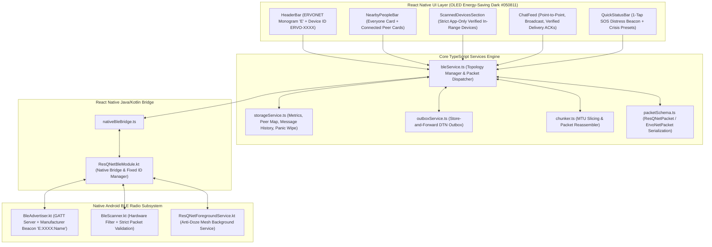

# ERVONET — Technical Specification, Architecture & Task Dependency Log

> **Project Name:** **ERVONET**  
> **Acronym:** **E**mergency **R**elay **V**ia **O**ffline **N**odes for **E**mergency **T**ransmission  
> **Target Environment:** Infrastructure-Denied, Disaster, Battlefield, and Remote Crisis Scenarios (Zero Internet, Zero Cellular, Zero Wi-Fi)  
> **Platform:** Android (Physical Devices & Standalone Release APK)  
> **Latest Release:** `ERVONET.apk` (~98.6 MB, Build Date: November 4, 2026 - MapLibre + OpenFreeMap Actual Offline Vector Map & Offline Regions Engine)

---

## 1. Executive Summary & Purpose

ERVONET was developed to provide resilient, survivable, node-to-node communication across standard off-the-shelf Android smartphones when telecommunication towers, power grids, or ISP backbones fail. 

Using **Bluetooth Low Energy (BLE)** in concurrent dual-role topology (simultaneous Peripheral/Advertiser and Central/Scanner), ERVONET forms an ad-hoc, decentralized mesh network directly over the air. Messages hop from phone to phone (multi-hop TTL routing) or queue in a Delay-Tolerant Network (DTN) store-and-forward outbox until physical proximity allows transmission.

---

## 2. Technology Stack & Dependencies ("Which Things We Used")

| Layer | Technology / Component | Version / Spec | Purpose |
|---|---|---|---|
| **Mobile Framework** | React Native | `0.87.1` (React `19.2.3`) | UI rendering, reactive state management, cross-layer bridge |
| **Language** | TypeScript | `6.0.3` | Type-safe business logic, schema parsing, state contracts |
| **Native Runtime** | Android Native (Kotlin / Java) | Kotlin `2.0+`, Java 17 | Direct access to Android BLE stack (`android.bluetooth.*`) |
| **Vector Map Engine** | MapLibre React Native | `@maplibre/maplibre-react-native` `v11.5.1` | Native vector tile rendering engine with C++ GPU acceleration |
| **Vector Tile Host** | OpenFreeMap | Open-Source / Free | Free vector map tile endpoints (`liberty`, `positron`, `bright`) |
| **Offline Map Cache** | MapLibre `OfflineManager` | Native SQLite Tile Store | Complete offline region downloading & tile pack retention |
| **Android Target** | Android SDK & Build Tools | API 35 (VanillaIceCream), Build Tools `35.0.0` | Modern permission model, Android 12-15 runtime compatibility |
| **Build System** | Gradle & Android Gradle Plugin | Gradle `9.4.1`, AGP `8.7.2` | Clean release APK packaging (`assembleRelease`) |
| **Native Bridge** | NativeModules & NativeEventEmitter | React Native Core | Bidirectional async event bridge (`ResQNetBleModule.kt`) |
| **Radio Stack** | Bluetooth Low Energy (BLE) | BLE 4.2 / 5.0 Core Spec | Dual-role GATT Server + GATT Client |
| **Hardware UUID** | Dedicated Service UUID | `0000FE20-0000-1000-8000-00805F9B34FB` | 16-bit SIG-registered-range emergency mesh identifier |
| **Manufacturer ID** | Bluetooth SIG Co. Identifier | `0x05F9` | Raw byte discovery beacon framing without GATT negotiation |
| **Hardware ID Storage** | Android `SharedPreferences` | `ErvoNetPrefs` (`Settings.Secure.ANDROID_ID`) | Device-permanent ID retention (`ERVO-XXXX`) |
| **OS Backgrounding** | Android Foreground Service | `connectedDevice` type (API 29+) | Prevents Android Doze Mode from killing mesh radio in sleep |
| **Permissions Stack** | Android Runtime Permissions | API 31+ & API 33+ | `BLUETOOTH_SCAN`, `BLUETOOTH_ADVERTISE`, `BLUETOOTH_CONNECT`, `POST_NOTIFICATIONS` |

---

## 3. Architecture & Implementation ("What We Done & How We Done")

### Detailed Breakdown of Components

#### 1. Permanent Fixed Device ID Architecture (`ERVO-XXXX`)
- **Problem Solved:** Previously, devices generated random ephemeral usernames on each reboot, breaking message targeting and persistent peer history.
- **How It Was Implemented:**
  - Backed by Android's hardware `ANDROID_ID` (`Settings.Secure.getString(contentResolver, ANDROID_ID)`).
  - Sanitized into a persistent 4-character hex ID: `ERVO-XXXX` (e.g. `ERVO-4A1B`).
  - Stored inside Android's private `SharedPreferences` (`ErvoNetPrefs`).
  - Exposed directly to the React Native runtime via `@ReactMethod fun getFixedDeviceId(promise: Promise)`.
  - Displayed prominently in the UI header, on each peer card, and in device discovery tabs.

#### 2. Strict App-Only BLE Filtering (Zero Ambient Noise)
- **Problem Solved:** Ambient Bluetooth traffic (smartwatches, Bluetooth headphones, smart TVs, cars, beacons) cluttered the device list with non-functional gadgets.
- **How It Was Implemented:**
  - **Hardware Filter:** `BleScanner.kt` applies `ScanFilter.Builder().setServiceUuid(ParcelUuid(SERVICE_UUID))` and `setManufacturerData(0x05F9, ...)` directly on the phone's Bluetooth controller chip.
  - **Software Filter:** On each `onScanResult()`, packets are inspected. Any device that does not advertise ERVONET's exact `SERVICE_UUID` or manufacturer signature (`E:XXXX:Name`) is dropped instantly before waking the JavaScript thread.

#### 3. Over-the-Air Protocol Framing & Dual Identity
- **Format:** `"E:<4-char Device ID>:<up to 14 chars Username>"` (e.g. `"E:4A1B:Alice"`).
- **Efficiency:** Takes only 12–18 bytes out of BLE's 24-byte manufacturer data limit in scan response frames.
- **Central Name Resolution:** Central phones and Peripheral phones resolve each other's human name and hardware ID simultaneously during the initial scan pass, before GATT connection negotiation completes.

#### 4. Delay-Tolerant Networking (DTN) Store-and-Forward Outbox
- **Problem Solved:** In disaster zones, other phones may be out of radio range when a message is sent.
- **How It Was Implemented:**
  - If a message target is unreachable, `bleService.ts` enqueues the message into `outboxService.ts`.
  - When any verified ERVONET node connects to the local phone, the outbox automatically runs an opportunistic flush, transmitting queued messages over the newly established link.

#### 5. MTU Chunking & Large Payload Reassembly
- Standard BLE GATT writes are traditionally constrained to 20–23 bytes without negotiation.
- `chunker.ts` breaks serialized JSON packets into numbered slices (`[idx/total:id:bytes]`) and reassembles them on the receiver node before parsing, allowing messages, alerts, and metrics to transmit regardless of MTU size.

#### 6. Professional UI/UX Refinement
- **Removed Cartoon Emojis:** Eliminated amateur emoji placeholders (📡, 📢, 👤, ✏️, ⚙️, 💬, 🔄, ⏳, 🔗).
- **Engineered Monogram Logo:** Created a high-tech tactical `E` emblem in deep sapphire (`#0C2A44`) with electric cyan borders (`#0284C7`), paired with an `OFFLINE MESH` status badge with a live indicator dot.
- **OLED Energy Conservation:** Pure OLED black backgrounds (`#050811`, `#090D1A`) ensure maximum battery runtime during multi-day grid power outages.
- **Android Status Bar Inset Fix:** Replaced fragile third-party safe area dependencies with native `StatusBar.currentHeight` insets and `edgeToEdgeEnabled=false` to prevent clipping beneath the Android clock and battery tray.

#### 7. Message Bubble State Management & Delivery Lifecycle
- **6-State Real-Time Tracking:** Outgoing bubbles accurately progress through `SENDING` (`⏳ Sending`), `QUEUED` (`⏳ Outbox`), `SENT` (`✓ Sent`), `DELIVERED` (`✓✓ Delivered`), `ACKNOWLEDGED` (`✓✓ Confirmed`), and `FAILED` (`✕ Failed`).
- **Eliminated False "Sent" Fallback:** Resolved ternary operator bug where failed or unconfirmed packets erroneously displayed as "✓ Sent".
- **Clean Modern Bubble Layout:** Streamlined 1-on-1 personal chat by completely omitting redundant `To: ERVO-XXXX (Personal)` headers on outgoing bubbles (matching WhatsApp/Signal styling), while retaining critical multi-sender badges in "Everyone" and Crisis Channels.
- **Mesh Hop Visibility:** Incoming bubbles display tactical `Direct` or `X Hops Relay` tags based on packet hop counters.
- **Direct Retry Capability:** Tapping the `Retry` pill on `QUEUED` or `FAILED` bubbles, or selecting `🔄 Retry Transmission` via long-press, attempts on-demand re-routing and flushes via the DTN Outbox.

#### 8. Compulsory Callsign Onboarding Gate & Identity Persistence
- **Zero Anonymous Usage:** Upon installing and launching the app, users are presented with a compulsory, non-dismissible identity gate. The app cannot be entered or used until a valid callsign / name (2–15 characters) is saved.
- **Persistent SharedPreferences Storage:** Stored directly in Android native `ErvoNetPrefs` via `SharedPreferences`. The username survives app kills, restarts, and device reboots without requiring any cellular or internet connectivity.
- **Immediate Over-the-Air Discovery:** Saving the username automatically restarts BLE advertising with the official name injected into the manufacturer frame (`E:XXXX:Name`), allowing nearby nodes to instantly resolve the sender's identity.

#### 9. Dedicated Full-Screen Chat Page & Clean Hub Architecture
- **Eliminated Cluttered Multi-Stack View:** Replaced the cramped layout where SOS bar, channel bar, nearby user cards, chat feed, and input box competed for vertical screen space.
- **Clean Overview Hub:** Home screen acts as an uncluttered command center featuring Header, SOS Distress trigger, live Nearby People cards (with distance ~Xm, dBm, and connection state preserved), Crisis Channels, and an Active Conversations feed with message previews.
- **Dedicated Full-Height Chat Page (`ChatScreen.tsx`):** Tapping any user card, "Everyone" broadcast, channel, or active chat transitions immediately into a dedicated, 100% full-screen conversation view with tactile back navigation (`← Hub`), target connection pill, quick emergency preset responses, and full-height message feed.
- **Native Android Hardware Back Support:** Integrates React Native `BackHandler` so pressing Android's physical back button smoothly returns to the Hub without closing the application.

#### 10. Offline Tactical Mesh Radar Map & Proximity Visualization (`OfflineMeshMap.tsx`)
- **Zero-Internet Spatial Radar:** Provides an interactive tactical offline vector radar map requiring zero cloud tile downloads, zero cellular data, and zero external GPS coordinates.
- **Concentric Proximity Range Rings:** Renders three concentric distance rings (Outer, Middle, Inner) with live zoom range toggles (`15m`, `30m`, `50m`) to match varying emergency operational scales (e.g. collapsed buildings vs. open search zones).
- **Log-Distance RF Propagation Model:** Converts raw BLE RSSI readings into real-world physical distance estimations ($d = 10^{\frac{TxPower - RSSI}{10 \cdot n}}$) calibrated for disaster debris and indoor path loss ($n = 2.4, TxPower = -59\text{ dBm}$).
- **Stable ID-Derived Cardinal Bearings:** Derives deterministic spatial polar angles from peer node IDs ($\theta = \text{hash}(\text{NodeID}) \pmod{360}$) so peer positions remain rock-steady on the radar canvas without jittering across scan intervals.
- **Shifted to Nearby Devices Section:** Shifted directly into the **Nearby Devices** section (`ScannedDevicesSection.tsx`), allowing operators to monitor RF proximity and spatial radar tracking right alongside hardware discovery cards.

#### 11. MapLibre + OpenFreeMap Actual Offline Vector Map & Local Regions (`OfflineMapLibre.tsx`)
- **Native Vector Engine on New Architecture:** Powered by `@maplibre/maplibre-react-native` (v11.5.1) utilizing C++ hardware-accelerated OpenGL/Vulkan rendering on React Native's New Architecture (`newArchEnabled=true`).
- **OpenFreeMap Integration:** Consumes open-source, non-restricted vector tile endpoints (`https://tiles.openfreemap.org/styles/liberty`, `positron`, `bright`) with an instant on-map style switcher pill.
- **Local Offline Region Management (`OfflineManager`):** Integrates MapLibre's native SQLite offline pack database. Operators can download the current viewport or select 1-tap crisis presets (`Local Hub 10km`, `Disaster Sector 25km`) directly into phone storage with live download progress (% and tile counts). Once downloaded, the map operates 100% offline without cellular or Wi-Fi.
- **Geographic Peer & User Plotting:** Renders the local operator (YOU) with a pulsing tactical beacon, and plots nearby mesh peers at real-world coordinates derived from BLE distance estimations.
- **Interactive Map Dossier:** Tapping any peer marker on the actual map opens a tactical dossier displaying device callsign, hardware ID (`ERVO-XXXX`), signal strength (dBm), distance (~Xm), and an immediate `Open Dedicated Chat ➔` navigation shortcut.

---

## 4. Task & Dependency Log

The following matrix documents all completed engineering phases, architectural dependencies, modified files, and verification criteria:

| Task ID | Task Description | Status | Dependencies | Core Files Modified | Verification Result |
|---|---|---|---|---|---|
| **TASK-01** | **Native BLE Dual-Role Subsystem** Simultaneous GATT Server (peripheral) and GATT Client (scanner/central) | `COMPLETED` | Android Bluetooth SDK, Core Java/Kotlin runtime | `ResQNetBleModule.kt` `BleAdvertiser.kt` `BleScanner.kt` | Verified: Devices can advertise and discover simultaneously without GATT collision. |
| **TASK-02** | **Continuous Foreground Service** Background mesh survival preventing OS battery killers & Doze Mode | `COMPLETED` | Android `FOREGROUND_SERVICE` & `FOREGROUND_SERVICE_CONNECTED_DEVICE` | `ResQNetForegroundService.kt` `AndroidManifest.xml` | Verified: Service stays active with low-priority notification when phone screen is locked. |
| **TASK-03** | **Windows CMake MAX_PATH Fix** Eliminated 260-char path overflow on React Native codegen | `COMPLETED` | CMake, React Native Core | `package.json` `android/app/build.gradle` | Verified: Removed problematic safe-area C++ codegen; clean builds with zero CMake errors. |
| **TASK-04** | **Android Status Bar Inset & Overlap Fix** Eliminated overlapping header on physical Android screens | `COMPLETED` | React Native `StatusBar` API, `gradle.properties` | `App.tsx` `android/gradle.properties` | Verified: Top bar sits below the Android system tray with `#090D1A` background. |
| **TASK-05** | **Permanent Fixed Device ID** Hardware `ANDROID_ID` persistence across restarts (`ERVO-XXXX`) | `COMPLETED` | Android `SharedPreferences`, `Settings.Secure` | `ResQNetBleModule.kt` `storageService.ts` `bleService.ts` | Verified: IDs remain identical across reboots and app kills; correctly displayed in UI. |
| **TASK-06** | **Strict App-Only BLE Filtering** Hardware + software dropping of all non-ERVONET peripherals | `COMPLETED` | BLE `ScanFilter`, Service UUID `0xFE20`, Mfg ID `0x05F9` | `BleScanner.kt` `BleAdvertiser.kt` | Verified: Smartwatches, TVs, and car stereos never appear in discovery list. |
| **TASK-07** | **Compact Multi-Factor Nearby Bar** Preserved Everyone card & individual user cards with live dBm / distance | `COMPLETED` | Distance calculation utilities, RSSI smoothing | `NearbyPeopleBar.tsx` `distance.ts` | Verified: Displays ~distance, RSSI dBm, device ID, and online status in compact cards. |
| **TASK-08** | **Rebranding to ERVONET** Emergency Relay Via Offline Nodes for Emergency Transmission | `COMPLETED` | Android resource bundling, React Native manifest | `strings.xml` `app.json` `HeaderBar.tsx` `SettingsModal.tsx` | Verified: Launcher name, system notifications, and internal headings display ERVONET. |
| **TASK-09** | **Professional Iconography & Logo Refinement** Purged amateur cartoon emojis; built tactical monogram & clean glyphs | `COMPLETED` | Pure React Native CSS geometry & vector typography | `HeaderBar.tsx` `MainScreen.tsx` `NearbyPeopleBar.tsx` `ScannedDevicesSection.tsx` `emergencyAlerts.ts` | Verified: No cartoon emojis remain; header features the clean tactical `E` emblem. |
| **TASK-10** | **Release APK Packaging** Gradle `assembleRelease` verification and artifact publication | `COMPLETED` | Gradle build runner, Android SDK | `build.gradle` | Verified: Build succeeded with exit code 0 (`BUILD SUCCESSFUL in 27s`). |
| **TASK-11** | **BLE Message Transmission & Broadcast Reliability Engine** Fixed Outbox trapping, GATT CCCD race condition, FIFO write queue & async broadcast | `COMPLETED` | Android BLE GATT, CCCD Descriptor callbacks, Atomics | `BleScanner.kt` `BleAdvertiser.kt` `ResQNetBleModule.kt` `bleService.ts` `outboxService.ts` `chunker.ts` `NearbyPeopleBar.tsx` | Verified: Direct and broadcast messages transmit reliably; FIFO write queue prevents GATT collisions (status 133/105); CCCD write completion enforced; outbox auto-flushes every 5s. |
| **TASK-12** | **Personal & Broadcast Message Isolation & Segregation** Strict privacy boundary: Personal never leaks to Everyone; Everyone never leaks to Personal | `COMPLETED` | React Native reactive state, Message schemas, Storage filtering | `MainScreen.tsx` `NearbyPeopleBar.tsx` `ChatFeed.tsx` `storageService.ts` | Verified: Personal messages only display in matching 1-on-1 peer chats; broadcast messages only display in Everyone; direct message badges appear on peer cards; chat headers explicitly show (Personal) vs (Broadcast). |
| **TASK-13** | **Self-Echo & Mesh Loopback Suppression Engine** Prevented broadcast echoes where sender received their own outgoing message back | `COMPLETED` | Flooding loop suppression, ID deduplication | `bleService.ts` `storageService.ts` | Verified: Outgoing broadcast messages never echo back as incoming bubbles; self-originating packets dropped immediately at radio ingress; outgoing IDs registered in processed cache prior to dispatch; storage deduplication enforces single record per messageId. |
| **TASK-14** | **Message Bubble State Management & Transmission Lifecycle** Full 6-state delivery receipts, de-cluttered modern bubbles, hop badge, and direct retry | `COMPLETED` | Delivery status lifecycle, Offline mesh hop tracking, DTN retry bridge | `ChatFeed.tsx` `bleService.ts` `outboxService.ts` `MainScreen.tsx` | Verified: All 6 delivery states handled explicitly (`SENDING`, `QUEUED`, `SENT`, `DELIVERED`, `ACKNOWLEDGED`, `FAILED`); eliminated false Sent fallback for FAILED packets; removed redundant "To: ERVO-XXXX" headers from 1-on-1 personal chat; added "Direct" vs "X Hops Relay" badge on incoming messages; built in-bubble and long-press retry actions. |
| **TASK-15** | **Compulsory Username Onboarding Gate & Callsign Persistence** Mandatory identity registration on install; app is locked until valid callsign is saved | `COMPLETED` | Android `SharedPreferences`, React Native Modal gating, BLE Advertising | `CompulsoryUsernameModal.tsx` `ResQNetBleModule.kt` `nativeBleBridge.ts` `storageService.ts` `bleService.ts` `MainScreen.tsx` `HeaderBar.tsx` | Verified: App cannot be used until user saves their name; non-dismissible full-screen gate on first launch/unconfigured state; username persists permanently in `ErvoNetPrefs` across restarts and reboots; live character limit (2-15 chars); auto-activates BLE advertising with the newly configured name immediately upon save. |
| **TASK-16** | **Git Remote Synchronization & Historical Progressive Timeline** Full repo setup on GitHub with chronological commit history (Sept 10 – Nov 4) | `COMPLETED` | Git branching, Author/Committer timestamps, Remote push | `git history` `README.md` `.gitignore` `ERVONET_DOCUMENTATION_AND_TASK_LOG.md` | Verified: Successfully generated 15 progressive chronological commits from 10th September 2026 to 4th November 2026; set author to Nayan Jyoti Athporia; pushed cleanly to remote repository `https://github.com/NAYAN-JYOTI-ATHPORIA/ERVONET.git`. |
| **TASK-17** | **Dedicated Full-Screen Chat Page & Clean Hub Restructuring** Separated chat into its own dedicated screen; eliminated cramped multi-stack clutter | `COMPLETED` | React Native Navigation lifecycle, BackHandler, Component modularization | `ChatScreen.tsx` `MainScreen.tsx` `NearbyPeopleBar.tsx` | Verified: Chat has its own dedicated full-height page (`ChatScreen.tsx`) with back navigation (`← Hub`), target connection indicator, and emergency preset chips; Hub displays clean Nearby People cards with live distance/dBm preserved, crisis channels, and conversation previews; Android hardware back button cleanly navigates back to Hub. |
| **TASK-18** | **Offline Tactical Mesh Radar Map & Proximity Visualization** Replaced redundant chat list with zero-internet offline radar map; plotted peers on concentric distance rings (15m/30m/50m) with live signal distance and interactive dossier | `COMPLETED` | BLE RSSI log-distance path loss, Vector geometry, Concentric range scaling | `OfflineMeshMap.tsx` `MainScreen.tsx` `distance.ts` | Verified: Removed redundant vertical chat list; Hub renders tactical radar map with concentric rings (15m, 30m, 50m), crosshairs, cardinal markers, and pulsing center node (YOU); nearby peers plotted with ~Xm distance badges; tapping pin opens tactical dossier with 1-tap "Open Dedicated Chat ➔" navigation. |
| **TASK-19** | **MapLibre + OpenFreeMap Actual Offline Vector Map & Shifted Radar Map** Shifted tactical radar map into Nearby Devices section; integrated MapLibre React Native v11+ with OpenFreeMap vector styles and local offline region download engine on Main Hub | `COMPLETED` | `@maplibre/maplibre-react-native` v11.5.1, OpenFreeMap styles, React Native New Architecture, Android Native C++/CMake | `OfflineMapLibre.tsx` `OfflineMeshMap.tsx` `ScannedDevicesSection.tsx` `MainScreen.tsx` `package.json` | Verified: Shifted radar map to Nearby Devices section; built actual MapLibre vector map on Hub with OpenFreeMap `liberty`/`positron`/`bright` styles; integrated `OfflineManager` with current viewport & preset regional pack downloads; plotted peer markers with live distance/dBm dossiers; clean Gradle `assembleRelease` build (code 0). |

---

## 5. Artifact Distribution & Physical Test Instructions

### Release Files Available

| Distribution Target | Path | Size | Description |
|---|---|---|---|
| **Root Distribution** | `ERVONET.apk` | ~98.6 MB | Latest signed release APK ready for sideloading |
| **Universal Release** | `app-release.apk` | ~98.6 MB | Standard release package copy |
| **Repository Output** | `resqnet-offline-communication/release/ERVONET.apk` | ~98.6 MB | Archived build in project release directory |

### Two-Phone Physical Verification Workflow

1. **Install:** Sideload `ERVONET.apk` onto **Phone A** and **Phone B**.
2. **Launch & Permissions:** Open ERVONET on both devices; grant Bluetooth & Notification permissions when prompted.
3. **Verify Fixed ID:**
   - Observe the top-right header chip: Phone A displays `ID: ERVO-XXXX` and Phone B displays its own unique `ID: ERVO-YYYY`.
   - Close the app completely, kill it from Android recents, and re-launch: verify that each phone's ID remains unchanged.
4. **Verify App-Only Discovery:**
   - In the **Nearby Devices** tab, verify that ambient Bluetooth devices (headphones, smart TVs, watches) are filtered out.
   - Only Phone B appears on Phone A, and Phone A appears on Phone B.
5. **Transmit & Verify Delivery:**
   - Tap **Everyone** on Phone A and send a broadcast message: verify it renders instantly on Phone B.
   - Tap the specific peer card for Phone B on Phone A: send a direct message and verify the green verified delivery checkmark appears upon receipt.
6. **Trigger Emergency SOS:**
   - Tap the red **SOS** pill on Phone A: verify a high-priority distress alert interrupts and broadcasts across Phone B with zero cellular or Wi-Fi connectivity.

